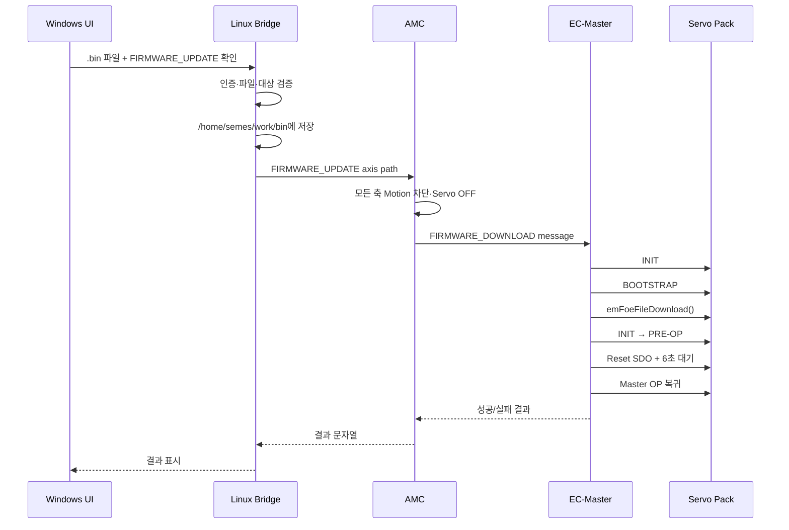

# Servo Maintenance

Windows IPC의 브라우저에서 서보 유지보수 작업을 수행하고, 실제 서보 통신과 변경 작업은 Linux 모션 제어기에서 수행하는 통합 유지보수 도구입니다.

이 저장소는 다음 문제를 해결하기 위해 개발되었습니다.

- 현장 작업자가 Linux 터미널 명령을 직접 입력하지 않고 Windows 화면에서 작업할 수 있어야 함
- Windows IPC에는 EtherCAT 제어 로직이나 서보 제조사 라이브러리를 설치하지 않아야 함
- Linux의 실시간 제어 프로세스와 기존 EC-Master 통신을 유지하면서 유지보수 명령을 전달해야 함
- 파라미터 파일과 펌웨어 파일을 작업자가 확인할 수 있는 Linux 경로에 보존해야 함
- 통신 상태, 펌웨어 버전, 파라미터 처리, 엔코더 리셋, 펌웨어 업데이트의 결과를 한 화면에서 확인해야 함

> 현재 구현의 핵심은 **Windows는 UI와 요청 전달만 담당하고, Linux의 AMC와 실행 중인 EC-Master가 실제 작업을 담당한다**는 점입니다.

---

## 1. 왜 이 구조가 필요한가

OHT의 실제 서보 제어는 Linux 모션 제어기에서 이루어집니다. Linux에는 EC-Master가 EtherCAT 주기 통신을 수행하고, AMC가 축 제어와 서보 상태를 관리합니다.

반면 현장 작업자는 Windows IPC 환경에 익숙하고, Linux 터미널에서 다음 명령을 직접 입력하는 방식은 작업성·교육성·오입력 방지 측면에서 불리합니다.

- 소켓 명령 직접 입력
- 파일 경로 직접 입력
- 축 번호 직접 입력
- 펌웨어 파일 복사
- 통신 결과와 오류 로그 확인
- Python 실행 환경과 경로 확인

따라서 Windows에는 유지보수 화면만 제공하고, Linux에 있는 실제 제어 기능은 그대로 유지하는 구조를 선택했습니다.

이 방식의 장점은 다음과 같습니다.

| 목표 | 적용 방식 |
| --- | --- |
| 작업자 편의성 | Windows 브라우저에서 버튼과 파일 선택으로 실행 |
| 실시간 제어 보존 | EtherCAT 처리는 Linux EC-Master가 계속 담당 |
| 역할 분리 | Windows는 UI, Linux는 제어·검증·실행 |
| 파일 추적성 | 업로드 파일을 Linux `/home/semes/work/bin`에 보존 |
| 오류 방지 | 토큰, IP, 축, 확장자, 파일 크기, 확인 문구 검증 |
| 운영 단순화 | Linux에서 Web과 Bridge를 한 명령으로 실행 가능 |
| 확장성 | AMC UNIX socket 명령과 EC-Master message queue를 분리 |

---

## 2. 전체 구조


### 네트워크 경계

| 구간 | 주소 | 공개 범위 | 역할 |
| --- | --- | --- | --- |
| Windows → Linux Web | `192.168.0.2:18765` | Windows IPC에 공개 | HTML UI 제공 |
| Linux Web → Bridge | `127.0.0.1:18766` | Linux 내부 전용 | 인증된 유지보수 요청 전달 |
| Bridge → AMC | `/tmp/amc_rsa_maintenance.sock` | Linux 로컬 | AMC 명령·결과 전달 |
| AMC → EC-Master | SysV message queue | Linux 프로세스 내부 | SDO/FoE 작업 요청 |
| EC-Master → Servo | EtherCAT | 장비 내부 | 실제 서보 통신 |

Bridge 포트 `18766`은 Windows에 공개하지 않습니다. Windows는 Web 포트 `18765`만 접속합니다.

---

## 3. 계층별 책임

### Windows IPC

Windows에는 유지보수 실행 프로그램을 설치하지 않습니다.

Windows가 담당하는 일:

- 브라우저로 Linux Web UI 표시
- 상태 조회 버튼 요청
- 펌웨어 버전 조회 요청
- 절대치 엔코더 리셋 요청
- 파라미터 파일 업로드
- 펌웨어 파일 업로드
- Linux가 반환한 결과 표시

Windows가 담당하지 않는 일:

- EtherCAT 프레임 송수신
- EC-Master 실행
- AMC 실행
- SDO 직접 처리
- FoE 직접 처리
- 서보 상태 전환
- 펌웨어 파일의 실제 다운로드

### Linux Web UI

`linux/servo_maintenance_web.py`가 Linux에서 HTML을 제공합니다.

- Web 주소: `0.0.0.0:18765`
- Windows 브라우저 허용 IP: 설정된 `allowed_browser_ip`
- 최신 유지보수 UI 제공
- IE 호환성을 고려한 XMLHttpRequest와 HTML form 사용
- 요청을 Bridge의 내부 TCP 프로토콜로 변환
- 다른 사이트에서 보낸 POST 차단: `Origin`이 다르면 거부하고, 엔코더 리셋은 `application/json` 요청만 받음
- 파일 업로드는 자체 multipart 파서로 처리 (Python 3.13에서 제거된 `cgi` 모듈을 사용하지 않음)
- 업로드 결과는 숨은 iframe으로 받으므로, IE 기본 오류 페이지가 결과를 가리지 않도록 HTTP 200과 JSON `ok` 값으로 응답

### Linux Bridge

`linux/servo_maintenance_tcp_bridge.py`가 Web UI와 AMC 사이를 연결합니다.

- shared token 인증
- 허용 IP 확인
- 요청 명령 검증
- 축 번호 검증
- 파일명 검증
- 파일 크기 제한
- 파일 저장 및 덮어쓰기 방지
- AMC UNIX socket 명령 전달
- 한 번에 하나의 유지보수 명령만 실행: 실행 중에 들어온 요청은 기다리지 않고 `another maintenance operation is running`으로 즉시 거부 (펌웨어 업데이트 중 화면이 멈춘 것처럼 보이는 문제 방지)

Bridge는 EtherCAT 라이브러리를 직접 호출하지 않습니다. 또한 별도의 외부 펌웨어 실행 프로그램을 생성하지 않습니다.

### AMC

AMC는 `amc_oht` 유지보수 UNIX socket(`/tmp/amc_rsa_maintenance.sock`)으로 명령을 받습니다.
이 socket 수신 스레드와 아래 명령 처리는 모두 `0005` diff가 `amc_oht.cpp`에 추가하는 코드입니다.

- `STATUS`
- `FW_VERSION <axis>`
- `ABS_RESET <axis>`
- `PARAM_READ <axis> <path>`
- `PARAM_UPDATE <axis> <path>`
- `FIRMWARE_UPDATE <axis> <path>`

> `ABS_RESET`과 `PARAM_UPDATE`는 원본 Controller 소스의 `AbsoluteEncoderReset()`, `UpdateServoParameter()`를 호출합니다.
> 이 두 함수는 diff에 포함되어 있지 않으므로, 적용 대상 원본 소스에 있어야 빌드됩니다.
>
> socket 권한은 `0600`입니다. Bridge(systemd `User=semes`)와 AMC가 **같은 Linux 사용자**로 실행되어야 접속할 수 있습니다.

AMC는 파일 자체를 EtherCAT으로 전송하지 않습니다. AxisModule과 EcServoMotor를 통해 EC-Master에 작업을 요청합니다.

### EC-Master

EC-Master는 기존 주기 통신 프로세스로 계속 실행됩니다.

펌웨어 업데이트 요청이 들어오면 내부 message queue를 통해 다음을 수행합니다.

- 대상 Slave 확인
- Servo OFF와 모션 차단 상태 확인
- 대상 Slave 상태 전환
- Acontis FoE API 호출
- 펌웨어 완료 후 Servo reset SDO 실행
- Master OP 복귀
- 결과를 AMC로 반환

---

## 4. 기능과 명령 흐름

| 화면 기능 | Web 요청 | AMC 명령 | 실제 처리 |
| --- | --- | --- | --- |
| 통신 상태 | `status` | `STATUS` | AMC와 서보 연결 상태 확인 |
| 펌웨어 버전 | `firmware_version` | `FW_VERSION <axis>` | SDO `0x100A:0` 읽기 |
| 절대치 엔코더 리셋 | `absolute_reset` | `ABS_RESET <axis>` | 기존 AbsoluteEncoderReset 호출 |
| 파라미터 읽기 | `parameter_read` | `PARAM_READ <axis> <path>` | Linux 저장 파일을 AMC가 읽음 |
| 파라미터 변경 | `parameter_update` | `PARAM_UPDATE <axis> <path>` | 기존 UpdateServoParameter 호출 |
| 펌웨어 업데이트 | `firmware_update` | `FIRMWARE_UPDATE <axis> <path>` | EC-Master FoE 실행 |

### 축 매핑

| UI 대상 | AMC/EC-Master 축 | 비고 |
| --- | ---: | --- |
| Driving | 0 | Front/Rear Dual Servo Pack |
| Hoist | 2 | Hoist Servo |
| Slide | 3 | Slide Servo |
| Rear | 1 | Driving Dual Pack의 반대 축. 펌웨어 대상은 Driving Pack 단위 |

축 매핑은 `linux/servo_maintenance.ini`의 `[firmware]`에서 설정합니다.

---

## 5. TCP 프로토콜

Web과 Bridge 사이에는 외부 의존성이 없는 간단한 길이 프레임 프로토콜을 사용합니다.

### 요청 형식

```
[4-byte unsigned big-endian JSON 길이]
[UTF-8 JSON header]
[선택적 raw file payload]
```

예시 헤더:

```json
{
  "protocol": "SMT1",
  "token": "공유 토큰",
  "command": "firmware_update",
  "axis": -1,
  "payload_length": 1048576,
  "filename": "hoist.bin",
  "target": "hoist",
  "confirmation": "FIRMWARE_UPDATE"
}
```

### 응답 형식

응답도 길이 프레임 JSON 하나입니다.

```json
{
  "ok": true,
  "message": "OK FIRMWARE_UPDATE Axis=2 ..."
}
```

이 구조를 사용한 이유는 Windows 파일 경로와 Linux 파일 경로를 직접 섞지 않기 위해서입니다. Windows가 보낸 파일의 원본 이름과 바이트 데이터만 전달하고, Linux가 안전한 파일명과 Linux 경로를 다시 생성합니다.

---

## 6. 파일 저장 정책

파일 업로드는 Bridge에서 처리합니다.

### 저장 위치

```
/home/semes/work/bin/<원본 파일명>
```

### 파라미터 파일

- 기본 최대 크기: 1 MiB
- 허용 문자: 영문, 숫자, 점, 밑줄, 하이픈
- 임시 파일에 먼저 기록
- `fsync` 후 원자적 rename
- 최종 파일 권한: `0600`

### 펌웨어 파일

- 확장자: `.bin`
- 기본 최대 크기: 8 MiB
- 빈 파일 거부
- 일반 파일인지 확인
- 경로가 `/home/semes/work/bin/` 하위인지 확인
- 파일명이 같고 내용이 같으면 기존 파일 재사용
- 파일명이 같고 내용이 다르면 덮어쓰지 않고 거부

이 정책은 잘못된 파일 선택이나 기존 작업 파일의 무단 덮어쓰기를 방지합니다.

---

## 7. 펌웨어 업데이트 시퀀스

펌웨어 업데이트는 일반 SDO 명령과 달리 서보의 부트스트랩 상태가 필요합니다. 따라서 EC-Master 프로세스를 종료하지는 않지만, 대상 Slave의 상태를 일시적으로 변경합니다.



### 내부 FoE 처리

1. AMC가 모션을 차단하고 모든 Servo를 OFF 상태로 요청합니다.
2. EC-Master message queue로 `FIRMWARE_DOWNLOAD`를 전달합니다.
3. 파일 경로가 허용된 Linux 작업 경로인지 확인합니다.
4. Station Address를 Acontis Slave ID로 변환합니다.
5. 대상 Slave를 `INIT`으로 전환합니다.
6. 대상 Slave를 `BOOTSTRAP`으로 전환합니다.
7. Acontis `emFoeFileDownload()`를 호출합니다.
8. FoE password `0x01020304`를 사용합니다.
9. 대상 Slave를 `INIT → PRE-OP`으로 복귀합니다.
10. Servo Pack 종류에 따라 reset SDO를 실행합니다.
11. 6초 대기 후 EC-Master Master OP 상태로 복귀합니다.
12. AMC가 결과와 펌웨어 버전을 반환합니다.

### Servo reset object

| 대상 제품 | Reset SDO |
| --- | --- |
| Driving Dual Servo Pack | `0x2C10:0 = 1` |
| Hoist / Slide Servo Pack | `0x3010:0 = 1` |

펌웨어 업데이트 중에는 기존 자동 OP 복구 로직이 Bootstrap 전환을 방해하지 않도록 `firmware_update_in_progress_` 상태를 사용합니다.

> EC-Master 프로세스가 살아 있다는 것과 Servo Pack이 업데이트 중에도 정상 운전 가능하다는 것은 다른 의미입니다. 업데이트 중에는 반드시 OHT를 정지하고 운전 명령을 보내지 않아야 합니다.

---

## 8. 설치 및 실행

### 8.1 Controller 소스에 변경 적용

현재 운용 중인 Controller 소스를 백업한 뒤 최신 Controller 원본에 적용합니다.

```bash
cd /home/semes/work/master_control

patch --dry-run -p1 < /경로/Servo_Maintenance/changes/0005-ecmaster-foe-firmware-update.diff
patch -p1 < /경로/Servo_Maintenance/changes/0005-ecmaster-foe-firmware-update.diff
```

또는 저장소 루트에서 제공하는 스크립트를 사용합니다.

```bash
./apply_controller_patch.sh /home/semes/work/master_control
```

그 후 기존 현장 빌드 절차로 다음 실행 파일을 다시 빌드·배포합니다.

- `ecmaster`
- `amc_oht`

빌드 후 기존 순서대로 EC-Master와 AMC를 실행하고 UNIX socket을 확인합니다.

```bash
test -S /tmp/amc_rsa_maintenance.sock && echo "AMC socket ready"
```

### 8.2 Linux 설정

`linux/servo_maintenance.ini`에서 반드시 공유 토큰을 변경합니다.

```ini
[server]
listen_host = 127.0.0.1
listen_port = 18766
shared_token = 16자_이상_랜덤_문자열
allowed_client_ip = 127.0.0.1
unix_socket = /tmp/amc_rsa_maintenance.sock
spool_dir = /home/semes/work/bin

[connection]
motion_ip = 127.0.0.1
tcp_port = 18766
shared_token = 위와_동일한_문자열

[web_ui]
host = 0.0.0.0
port = 18765
allowed_browser_ip = 192.168.0.3
```

토큰 생성 예시:

```bash
python3 -c 'import secrets; print(secrets.token_urlsafe(32))'
```

같은 토큰을 `[server]`와 `[connection]`에 입력해야 합니다.

### 8.3 Linux 수동 실행

```bash
cd /home/semes/work/bin/servo-maintenance
chmod +x run_linux.sh
./run_linux.sh
```

이 명령은 Bridge를 백그라운드로 실행한 뒤 Web UI를 실행합니다. Web 프로세스를 종료하면 Bridge도 함께 종료됩니다.

개별 진단이 필요할 때는 다음처럼 실행할 수 있습니다.

```bash
python3 linux/servo_maintenance_tcp_bridge.py --config linux/servo_maintenance.ini
python3 linux/servo_maintenance_web.py --config linux/servo_maintenance.ini
```

### 8.4 Linux systemd 자동 실행

```bash
sudo install -m 0644 linux/servo-maintenance-bridge.service.template \
  /etc/systemd/system/servo-maintenance-bridge.service

sudo install -m 0644 linux/servo-maintenance-web.service.template \
  /etc/systemd/system/servo-maintenance-web.service

sudo systemctl daemon-reload
sudo systemctl enable --now servo-maintenance-bridge.service
sudo systemctl enable --now servo-maintenance-web.service
```

상태 확인:

```bash
sudo systemctl status servo-maintenance-bridge.service
sudo systemctl status servo-maintenance-web.service
sudo journalctl -u servo-maintenance-bridge.service -n 100 --no-pager
sudo journalctl -u servo-maintenance-web.service -n 100 --no-pager
ss -ltn | grep -E '18765|18766'
```

정상적인 포트 상태:

- `0.0.0.0:18765`: Windows 브라우저 접속용
- `127.0.0.1:18766`: Linux Web과 Bridge 내부 통신용

### 8.5 Windows IPC 접속

Windows에는 Python이나 별도 실행 파일을 설치하지 않습니다.

1. `windows/Servo_Maintenance.url`을 Windows 바탕화면에 복사합니다.
2. 바로가기를 더블클릭합니다.
3. Internet Explorer에서 다음 주소가 열리는지 확인합니다.

```
http://192.168.0.2:18765/
```

---

## 9. 운영 순서

권장 작업 순서는 다음과 같습니다.

1. Linux에서 EC-Master와 AMC가 정상 실행 중인지 확인합니다.
2. AMC UNIX socket이 존재하는지 확인합니다.
3. Linux Web과 Bridge를 실행합니다.
4. Windows 브라우저에서 UI를 엽니다.
5. `Connection Status`로 통신 경로를 확인합니다.
6. `Firmware Version`으로 현재 버전을 확인합니다.
7. 필요한 경우 Parameter Read로 기존 파라미터를 백업합니다.
8. Parameter Update를 수행합니다.
9. 절대치 엔코더 리셋이 필요하면 OHT 정지 상태에서 수행합니다.
10. 펌웨어 업데이트는 장비 정지·Servo OFF·파일 확인 후 수행합니다.
11. 업데이트 완료 후 다시 Firmware Version을 확인합니다.
12. 작업 결과와 Linux 로그를 작업 기록에 보관합니다.

---

## 10. 안전 및 보안 정책

### 장비 안전

- 펌웨어 업데이트 전 OHT를 완전히 정지합니다.
- 업데이트 중 운전 명령을 전송하지 않습니다.
- Servo OFF와 모션 차단 결과를 확인한 뒤 업데이트합니다.
- 잘못된 Servo Pack 대상과 펌웨어 파일을 선택하지 않습니다.
- 업데이트 실패 시 반복 실행하지 말고 EC-Master와 AMC 로그를 먼저 확인합니다.
- 실제 장비 적용 전 검증용 Servo Pack에서 파일 호환성을 확인합니다.

### 통신 보안

- Bridge는 shared token을 비교합니다.
- Bridge는 허용된 client IP만 받습니다.
- Bridge는 Linux loopback에만 바인딩됩니다.
- Web UI는 허용된 Windows IPC IP만 받습니다.
- 파일명에 경로 문자를 허용하지 않습니다.
- 파일 경로는 `/home/semes/work/bin/` 하위로 제한됩니다.
- 동일 파일명에 다른 내용을 덮어쓰지 않습니다.
- UNIX socket 권한은 동일 Linux 사용자 중심으로 제한합니다.

---

## 11. 문제 해결

| 증상 | 확인 항목 |
| --- | --- |
| 브라우저가 열리지 않음 | Linux Web 실행 여부, `192.168.0.2` ping, TCP 18765 listen 여부 |
| authentication failed | `[server]`와 `[connection]`의 token이 같은지 확인 |
| client IP is not allowed | `allowed_browser_ip` 또는 Bridge 허용 IP 확인 |
| socket not found | `test -S /tmp/amc_rsa_maintenance.sock` 실행 |
| AMC CONNECTED 실패 | AMC 실행 여부와 UNIX socket 수신 스레드 확인 |
| FW_VERSION 실패 | Controller diff 적용 후 AMC 재빌드 여부 확인 |
| FIRMWARE_UPDATE 파일 오류 | 파일 확장자, 파일 크기, 저장 경로, 동일 파일명 내용 확인 |
| another maintenance operation is running | 다른 작업(특히 펌웨어 업데이트)이 끝난 뒤 다시 실행 |
| cross-site request is not allowed | 바로가기(`http://192.168.0.2:18765/`)로 연 화면에서만 실행 |
| AMC socket Permission denied | AMC와 Bridge 실행 사용자가 같은지 확인 (socket 권한 `0600`) |
| Bus configuration mismatch | EtherCAT Slave 연결, XML/YML 설정, 실제 장치 구성을 확인 |
| FoE 실패 | Servo Pack 지원 여부, Bootstrap 상태 전환, 펌웨어 호환성, EC-Master 로그 확인 |
| 업데이트 후 OP 복귀 실패 | reset SDO 결과와 Servo Pack 전원·네트워크 상태 확인 |

---

## 12. 파일 구조

```
Servo_Maintenance/
├── README_KO.md
├── GIT_INIT_KO.md
├── apply_controller_patch.sh
├── run_linux.sh
├── common/
│   └── maintenance_protocol.py
├── linux/
│   ├── servo_maintenance_web.py
│   ├── servo_maintenance_tcp_bridge.py
│   ├── servo_maintenance.ini
│   ├── servo-maintenance-bridge.service.template
│   └── servo-maintenance-web.service.template
├── windows/
│   ├── Servo_Maintenance.url
│   └── README_KO.txt
├── controller_patch/
│   └── src/
├── changes/
│   ├── 0005-ecmaster-foe-firmware-update.diff
│   └── README_KO.md
├── docs/
│   └── remote_maintenance_spec_ko.md
└── tests/
    ├── test_bridge_integration.py
    ├── test_linux_web.py
    ├── test_maintenance_protocol.py
    └── test_source_contract.py
```

---

## 13. 테스트와 검증

Python 테스트 실행:

```bash
python3 -m unittest discover -s tests -v
```

Python 문법 검사:

```bash
python3 -m py_compile \
  common/maintenance_protocol.py \
  linux/servo_maintenance_tcp_bridge.py \
  linux/servo_maintenance_web.py
```

Shell 문법 검사:

```bash
sh -n apply_controller_patch.sh run_linux.sh
```

Controller diff 적용 전 검사:

```bash
patch --dry-run -p1 -d /home/semes/work/master_control \
  < changes/0005-ecmaster-foe-firmware-update.diff
```

현재 자동 테스트는 다음을 확인합니다.

- 길이 프레임 송수신
- TCP round trip
- shared token과 IP 검증
- 축과 펌웨어 대상 검증
- 파일 크기와 확장자 검증
- 동일 파일 재사용과 덮어쓰기 방지
- Web API 요청 변환
- IE 호환 JavaScript 문법
- 외부 펌웨어 실행 프로세스 미사용
- EC-Master FoE 소스 계약
- Controller diff와 전체 변경 파일 일치
- 실행 중 요청 즉시 거부, `True` 같은 bool 축 값 거부, 한글 토큰 처리
- Windows 전체 경로 파일명을 기본 이름으로 저장
- 다른 사이트 POST 차단과 펌웨어 바이너리 multipart 무손실 전달

지원 Python: 3.5 이상 (3.13 포함). 3.11과 3.13에서 테스트를 실행했습니다.

실제 Servo Pack에 대한 FoE 전송과 전체 Controller 바이너리 빌드는 장비와 현장 빌드 의존성이 필요하므로, 검증 장비에서 별도로 수행해야 합니다.

---

## 14. 관련 문서와 이력

- Controller 적용 안내: `changes/README_KO.md`
- 원격 유지보수 상세 사양: `docs/remote_maintenance_spec_ko.md`
- Git 초기화 안내: `GIT_INIT_KO.md`
- Controller 변경 diff: `changes/0005-ecmaster-foe-firmware-update.diff`

이 저장소의 기준 브랜치는 `main`입니다.